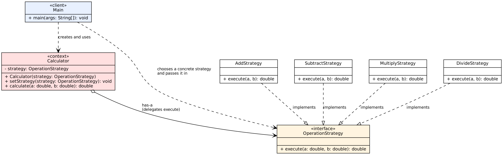
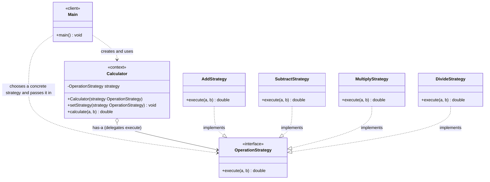

# Assignment 5: Strategy Pattern

Student: Zhassyn Zhalynuly SE-2527  
Option: B, Calculator  
GitHub: https://github.com/zzhassyn/sdp-strategy

## 1. Introduction

I chose Option B, a calculator. The calculator takes two numbers and performs one operation
on them. The operation can be different, and each one is a separate algorithm:

| Operation | Formula |
|-----------|---------|
| Add | a + b |
| Subtract | a - b |
| Multiply | a * b |
| Divide | a / b (division by zero is rejected) |

The family of algorithms is "calculate a result from two numbers". All operations have the
same input (`a`, `b`) and the same result type (`double`), but they calculate it differently.

If all operations were inside one `Calculator` class, it would need a chain of `if` or
`switch` on the operation. Every new operation would mean editing that class, and a mistake
in one branch could break the others. With Strategy, each operation is a separate class that
implements the interface `OperationStrategy`. `Calculator` keeps one strategy and calls it.
The client chooses the strategy and can replace it at runtime with `setStrategy(...)`.

| Pattern role | Class |
|--------------|-------|
| Strategy interface | `OperationStrategy` |
| Concrete strategies | `AddStrategy`, `SubtractStrategy`, `MultiplyStrategy`, `DivideStrategy` |
| Context | `Calculator` |
| Client | `Main` |

## 2. UML Class Diagram



The picture is in the repository (`docs/uml.png`). The same diagram as text:



`Calculator` depends only on the interface. The four concrete strategies are on the other
side of it, so `Calculator` does not know them.

## 3. Clean Code

Each principle below has an annotated excerpt from the project.

### 3.1 Polymorphism instead of if/switch

The operation is not chosen with conditions. It is chosen by the object that is currently
inside `Calculator`.

```java
// Calculator.calculate(): one line replaces the whole chain of if/switch on the operation
public double calculate(double a, double b) {
    return strategy.execute(a, b);
}
```

`Calculator` has no `if` or `switch` at all. A new operation does not add a branch here.

### 3.2 Meaningful names

Names say what the thing does, so the code can be read without comments.

```java
public interface OperationStrategy {
    double execute(double a, double b);                            // verb + what it works with
}
public class AddStrategy implements OperationStrategy { ... }      // operation + role
public class SubtractStrategy implements OperationStrategy { ... }
```

### 3.3 Single Responsibility

A strategy has one reason to change: its own formula. It does not print, read input or know
about other strategies. This is the whole `SubtractStrategy`:

```java
public class SubtractStrategy implements OperationStrategy {

    @Override
    public double execute(double a, double b) {
        return a - b;
    }
}
```

If one operation has a bug, only its class is fixed and tested.

### 3.4 The context does not know the algorithms

`Calculator` has no `import` of any concrete strategy and never checks the type of its
strategy. It sees only the interface:

```java
import kz.aitu.sdp.strategy.strategy.OperationStrategy;   // no AddStrategy, SubtractStrategy, ...

private OperationStrategy strategy;                        // the field has the interface type
```

This is the Dependency Inversion idea: a high-level class depends on an abstraction, not on
details.

### 3.5 Easy extension (Open/Closed)

`DivideStrategy` was added after the first three strategies, `Calculator` and `Main` were
written. The commit "Add DivideStrategy as a new strategy" adds this one file and changes
nothing else:

```java
public class DivideStrategy implements OperationStrategy {

    @Override
    public double execute(double a, double b) {
        if (b == 0) {
            throw new ArithmeticException("Cannot divide by zero");
        }
        return a / b;
    }
}
```

The client only has to choose it:

```java
calculator.setStrategy(new DivideStrategy());
```

`Calculator`, `OperationStrategy` and the other strategies were not modified. Since a
strategy is just an interface, a client can also pass a lambda, for example
`calculator.setStrategy((a, b) -> Math.pow(a, b))`.

### 3.6 Error handling in the right place

The rule "you cannot divide by zero" belongs to division, so it lives in `DivideStrategy`
and nowhere else. `Calculator` does not need to know about it, and the other operations are
not affected.

```java
// DivideStrategy.execute()
if (b == 0) {
    throw new ArithmeticException("Cannot divide by zero");   // clear message, thrown at once
}
return a / b;
```

```java
// Main: the client decides what to do with the error
try {
    calculator.calculate(a, 0);
} catch (ArithmeticException e) {
    System.out.println("Error: " + e.getMessage());
}
```

### 3.7 Fail fast

An invalid strategy is rejected at the moment it is set, with a clear message. Without this
check, a `null` strategy would fail later, inside `calculate`, with a confusing
`NullPointerException`.

```java
// Calculator
public void setStrategy(OperationStrategy strategy) {
    this.strategy = Objects.requireNonNull(strategy, "Operation strategy must not be null");
}
```

The constructor calls `setStrategy`, so the same check works for both.

## 4. Strategy vs. State

My problem needs Strategy because the question is "which operation should calculate the
result?" and not "in which stage is the object?". Add, Subtract, Multiply and Divide are
four ways to solve the same task, and the client picks one with `setStrategy(...)`. The
strategies do not know each other: `AddStrategy` never switches the calculator to
`MultiplyStrategy`, and any strategy can follow any other. In State it is the opposite. The
current state decides the next one (for example `Moderation.approve()` installs
`Published`), and some transitions are forbidden, like approving a `Draft` before
moderation. The UML diagrams of both patterns look the same, and both change behaviour at
runtime, so what really separates them is who makes the choice and whether there is a life
cycle.

## 5. Conclusion

What I got: no `if` or `switch` on the operation, one new class for a new operation
(Divide needed nothing else), small classes that are easy to test, and a strategy that can
be changed while the program runs.

What it cost: instead of one class with a `switch` there are now an interface, four
strategies and a context. Each strategy is only one line of logic, so for such a small
example the number of classes looks large. The client also has to know the concrete
strategies to choose one.

For two or three simple operations that never change, a plain `switch` would be shorter.
The pattern becomes worth it when operations keep growing (power, modulo, square root) or
when an operation needs its own rules, like the zero check in division.

## 6. GitHub Repository

https://github.com/zzhassyn/sdp-strategy
